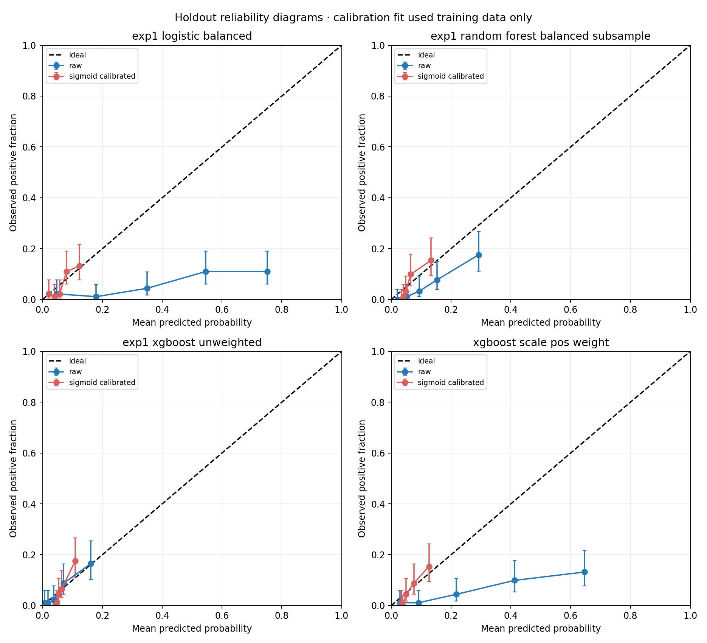

# Experiment 2 — calibration analysis

Sigmoid calibration was fit independently for each candidate using `CalibratedClassifierCV(method='sigmoid', ensemble=True, cv=5)` on the valid-weight training partition only. Each base pipeline re-fits preprocessing inside its calibration fold. The untouched holdout was used only to evaluate calibration and ranking after fitting. No calibration choice or parameter was selected from holdout results.

| Model | Raw holdout Brier | Raw stratified-bootstrap 95% CI | Sigmoid holdout Brier | Sigmoid stratified-bootstrap 95% CI | Raw AUC | Sigmoid AUC |
|---|---:|---:|---:|---:|---:|---:|
| exp1_logistic_balanced | 0.1993 | [0.1796, 0.2194] | 0.0545 | [0.0531, 0.0559] | 0.721 | 0.727 |
| exp1_random_forest_balanced_subsample | 0.0585 | [0.0529, 0.0638] | 0.0533 | [0.0508, 0.0556] | 0.799 | 0.808 |
| exp1_xgboost_unweighted | 0.0532 | [0.0502, 0.0560] | 0.0542 | [0.0527, 0.0555] | 0.779 | 0.786 |
| xgboost_scale_pos_weight | 0.1339 | [0.1194, 0.1496] | 0.0530 | [0.0513, 0.0546] | 0.754 | 0.778 |

Brier score evaluates probability error jointly with discrimination and outcome uncertainty; a lower Brier score alone does not prove calibration improved. Sigmoid is monotonic, so it can adjust scale while generally preserving ordering; compare its holdout AUC as well as reliability bins. Reliability diagrams use five equal-frequency holdout bins and show Wilson intervals for observed fractions. These plots are noisy because the holdout contains only 27 cases.

Isotonic calibration was not fit. The valid-weight training set has 88 cases; in five-fold calibration, each calibrator's validation partition sees roughly 17–18 cases, far below a comfortable amount for a flexible nonparametric calibration curve. scikit-learn cautions isotonic may overfit with far fewer than about 1,000 calibration samples. This is an explicit sample-size decision, not a missing result.

The CV and calibration are unweighted. They do not provide nationally representative probabilities. Scores must not be presented as calibrated personal diabetes risk or diagnosis.

scikit-learn calibration procedure: [CalibratedClassifierCV](https://scikit-learn.org/stable/modules/generated/sklearn.calibration.CalibratedClassifierCV.html) and [probability calibration guide](https://scikit-learn.org/stable/modules/calibration.html).
