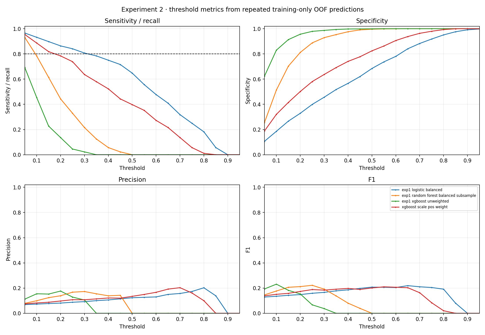

# Experiment 2 — threshold analysis

Thresholds are selected from repeated stratified out-of-fold predictions generated only within the valid-weight training partition (N=1,368; 88 positive). The original Experiment 1 split was preserved by positional index. Participants with no positive `WTSAF2YR` were removed from both partitions because the CDC codebook assigns zero fasting weights to people not fasted 8 to <24 hours; that includes fasting-glucose values that CDC says require reweighting to use. The cleaned holdout has N=455, with 27 positive cases.

The evaluation grid is 0.05–0.95 by 0.05. The training OOF grid is in `threshold_metrics.csv`; it contains sensitivity, specificity, precision, F1, balanced accuracy, false-positive and false-negative counts for every model/threshold. Threshold rules: max Youden J; max F1; highest grid threshold with sensitivity >=80% (or explicitly not achieved); and fixed 0.50 reference. Ties are resolved toward the higher threshold. Holdout labels were not used to choose any threshold.

## OOF-selected thresholds

| Model | Rule | OOF-selected threshold | OOF selection statistic |
|---|---|---:|---:|
| exp1_logistic_balanced | youden_j | 0.45 | 0.3362215909090911 |
| exp1_logistic_balanced | f1_optimized | 0.65 | 0.21951219512195122 |
| exp1_logistic_balanced | sensitivity_80 | 0.30 | 0.8068181818181818 |
| exp1_logistic_balanced | fixed_0_5 | 0.50 | reference |
| exp1_random_forest_balanced_subsample | youden_j | 0.15 | 0.3159801136363636 |
| exp1_random_forest_balanced_subsample | f1_optimized | 0.25 | 0.2222222222222222 |
| exp1_random_forest_balanced_subsample | sensitivity_80 | 0.05 | 0.9318181818181818 |
| exp1_random_forest_balanced_subsample | fixed_0_5 | 0.50 | reference |
| exp1_xgboost_unweighted | youden_j | 0.05 | 0.31583806818181825 |
| exp1_xgboost_unweighted | f1_optimized | 0.10 | 0.23121387283236994 |
| exp1_xgboost_unweighted | sensitivity_80 | not achieved | — |
| exp1_xgboost_unweighted | fixed_0_5 | 0.50 | reference |
| xgboost_scale_pos_weight | youden_j | 0.25 | 0.3191051136363636 |
| xgboost_scale_pos_weight | f1_optimized | 0.55 | 0.21016949152542372 |
| xgboost_scale_pos_weight | sensitivity_80 | 0.15 | 0.8181818181818182 |
| xgboost_scale_pos_weight | fixed_0_5 | 0.50 | reference |

## Untouched holdout at transferred thresholds

| Model | Rule (chosen from training OOF) | Threshold | Sensitivity | Specificity | Precision | F1 | Balanced accuracy | FP | FN |
|---|---|---:|---:|---:|---:|---:|---:|---:|---:|
| exp1_logistic_balanced | youden_j | 0.45 | 0.741 | 0.624 | 0.110 | 0.192 | 0.682 | 161 | 7 |
| exp1_logistic_balanced | f1_optimized | 0.65 | 0.370 | 0.827 | 0.119 | 0.180 | 0.599 | 74 | 17 |
| exp1_logistic_balanced | sensitivity_80 | 0.30 | 0.889 | 0.481 | 0.098 | 0.176 | 0.685 | 222 | 3 |
| exp1_logistic_balanced | fixed_0_5 | 0.50 | 0.630 | 0.666 | 0.106 | 0.182 | 0.648 | 143 | 10 |
| exp1_random_forest_balanced_subsample | youden_j | 0.15 | 0.704 | 0.722 | 0.138 | 0.230 | 0.713 | 119 | 8 |
| exp1_random_forest_balanced_subsample | f1_optimized | 0.25 | 0.296 | 0.897 | 0.154 | 0.203 | 0.597 | 44 | 19 |
| exp1_random_forest_balanced_subsample | sensitivity_80 | 0.05 | 0.963 | 0.297 | 0.080 | 0.147 | 0.630 | 301 | 1 |
| exp1_random_forest_balanced_subsample | fixed_0_5 | 0.50 | 0.000 | 0.991 | 0.000 | 0.000 | 0.495 | 4 | 27 |
| exp1_xgboost_unweighted | youden_j | 0.05 | 0.815 | 0.638 | 0.124 | 0.216 | 0.726 | 155 | 5 |
| exp1_xgboost_unweighted | f1_optimized | 0.10 | 0.556 | 0.829 | 0.170 | 0.261 | 0.692 | 73 | 12 |
| exp1_xgboost_unweighted | fixed_0_5 | 0.50 | 0.000 | 1.000 | 0.000 | 0.000 | 0.500 | 0 | 27 |
| xgboost_scale_pos_weight | youden_j | 0.25 | 0.815 | 0.572 | 0.107 | 0.190 | 0.694 | 183 | 5 |
| xgboost_scale_pos_weight | f1_optimized | 0.55 | 0.444 | 0.855 | 0.162 | 0.238 | 0.650 | 62 | 15 |
| xgboost_scale_pos_weight | sensitivity_80 | 0.15 | 0.926 | 0.439 | 0.094 | 0.171 | 0.683 | 240 | 2 |
| xgboost_scale_pos_weight | fixed_0_5 | 0.50 | 0.444 | 0.808 | 0.128 | 0.198 | 0.626 | 82 | 15 |

The 80% sensitivity target is available for one or more candidate(s) only where a training-OOF grid threshold was found; see the tables below and CSV for exact outcomes.

The fixed 0.50 confusion matrices from Experiment 1 and Experiment 2 are not the same analysis population: Experiment 1 used 485 holdout rows including 30 with no positive fasting subsample weight; Experiment 2 evaluates the valid-weight subset. No threshold is a clinical operating point. The sensitivities/precisions are exploratory and highly uncertain with 27 holdout events.

See [`ROBUSTNESS_ANALYSIS.md`](ROBUSTNESS_ANALYSIS.md) for split and repeated-CV audit, and [`UPDATED_MODEL_COMPARISON.md`](UPDATED_MODEL_COMPARISON.md) for the decision.
