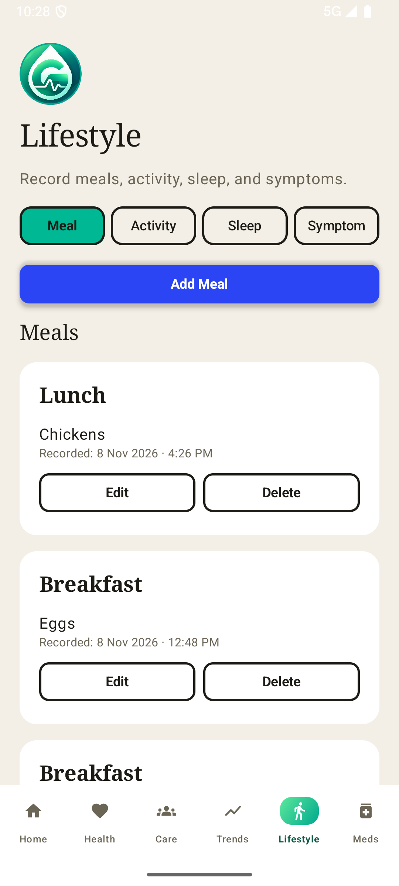
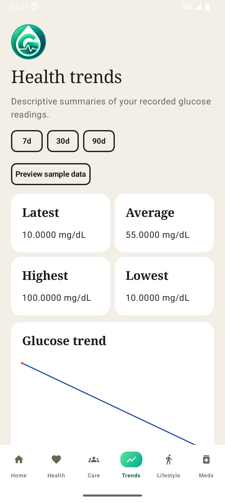

# Patient Mobile App

Native Android patient application for account access and consent-based doctor connections.

## Stack and setup

- Kotlin and Jetpack Compose with Material 3.
- Android application ID: `me.glycotwin.patient`.
- Minimum Android SDK: 26.
- Android Studio with an Android Emulator.
- Retrofit/Gson for HTTP, Coroutines/StateFlow for state, Android Keystore for session tokens.

Open `apps/patient_mobile` in Android Studio and select the `app` configuration after starting the API. PowerShell commands:

```powershell
.\gradlew.bat :app:assembleDebug
.\gradlew.bat :app:testDebugUnitTest
```

The API URL is a Gradle build property:

```powershell
.\gradlew.bat :app:assembleDebug "-PAPI_BASE_URL=http://10.0.2.2:5050/api/v1/"
```

`10.0.2.2` is the Android Emulator alias for the Windows host. If the emulator cannot reach the API through that alias, forward the port over ADB and build for emulator loopback.

```powershell
adb -s <emulator-serial> reverse tcp:5050 tcp:5050
.\gradlew.bat :app:assembleDebug "-PAPI_BASE_URL=http://127.0.0.1:5050/api/v1/"
```

Debug builds allow cleartext HTTP; production builds require HTTPS.

## Integrated workflow

- Signup starts a session and opens profile setup. Sign-in and signup sessions restore from encrypted storage for up to seven days.
- Profile has personal and health details, connected devices, care access, and **Account & security**. Confirm your current password to set a new password or delete your account.
- **Today → View health history** shows glucose, taken medication doses, lifestyle records, and watch activity with their source and time. Manual glucose entry, editing, and deletion are in Health.
- **Care** lists active doctor access, pending invitations, goals, follow-ups, and shared briefs. Accept an invitation, then choose **Prepare a visit brief** to share selected records. You can stop sharing a brief or end a doctor’s access from the same screen.

## Data connections

- Open **Data connections** from Today, Profile, or Trends. Pair the devices in Wear OS and install the GlycoTwin watch and phone builds with the same application ID and signing key. Enable **Share my latest glucose** and **Sync watch activity** independently. The phone retries watch uploads while the app is active, and a successful server response clears the corresponding watch queue item.
- Use **Find glucose sources** to grant Health Connect blood glucose permission. Select a source to import available readings from the last seven days. Records retain the source app and their measurement time. The API tracks when it receives them.
- The **Glucose replay** action is available to debug builds on an `@example.test` patient account. The API also requires local PostgreSQL and development demo mode. Replay creates labeled synthetic readings so the phone, watch, and clinician views can be exercised on test data.
- Set diabetes type and treatment context in Profile. The Medication screen records the scheduled time separately from when the user took the dose and the optional actual amount.

Synced workouts, steps, and pulse records also appear under **Lifestyle → Activity → From your watch**.


## Project Screenshots

<table>
  <tr>
    <td align="center">
      
      <br><strong>GlycoTwin Overview</strong>
    </td>
    <td align="center">
      
      <br><strong>Patient App</strong>
    </td>
    <td align="center">
      
      <br><strong>Dashboard</strong>
    </td>
    <td align="center">
      
      <br><strong>Health Tracking</strong>
    </td>
  </tr>

  <tr>
    <td align="center">
      
      <br><strong>Health Trends</strong>
    </td>
    <td align="center">
      
      <br><strong>Medicine Tracking</strong>
    </td>
    <td align="center">
      
      <br><strong>Doctor Connection</strong>
    </td>
  </tr>
</table>


## Signed tester releases

The phone and watch use Android application ID `me.glycotwin.patient` and must share the same release certificate. The phone release connects to `https://api.glycotwin.me/api/v1/`. Register this application ID when adding Firebase. Older installs with the previous ID are separate apps.

The Android phone beta and Android watch beta workflows run independently and manually. Create the GitHub environment `android-beta` and allow deployments from the `main` branch. The publish job uses GitHub's built-in token with repository contents write permission.

On the signing Windows account, sign in to the GitHub CLI with repository administrator access. Run `apps/patient_mobile/configure-github-signing.ps1` from PowerShell to populate the environment's two signing secrets and the expected certificate fingerprint and alias. The helper reads the keystore and Windows-encrypted password from `~/.glycotwin-signing`. Keep a separate secure backup of the keystore and a recoverable copy of the password in your password manager; the encrypted XML alone cannot restore the password on another computer.

Push the workflows and sources to the default branch. Open Actions > Android phone beta or Android watch beta > Run workflow, select main, and enter the next version number for that device. Each workflow tests, signs, and publishes its APK and checksum in a separate numbered release. The dashboard /download page finds each published APK independently. Both workflows use the same android-beta environment and signing certificate.
