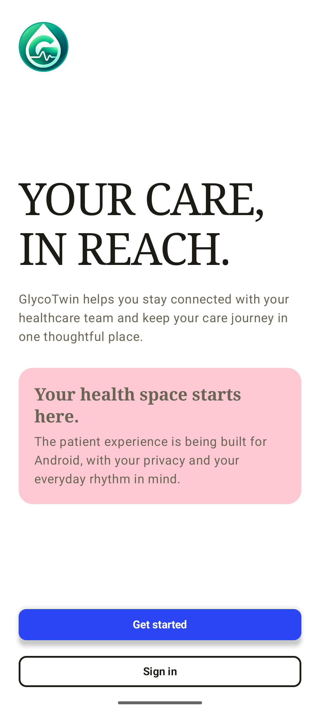
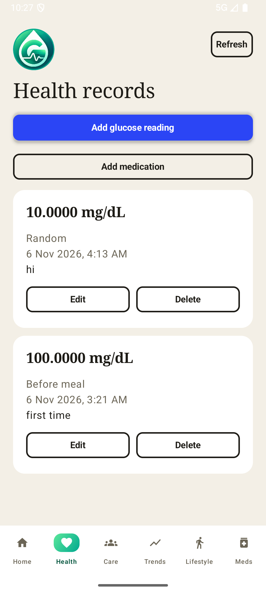
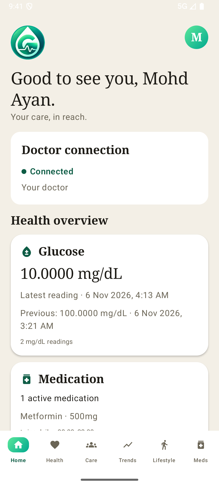
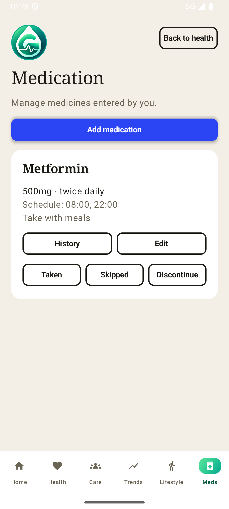
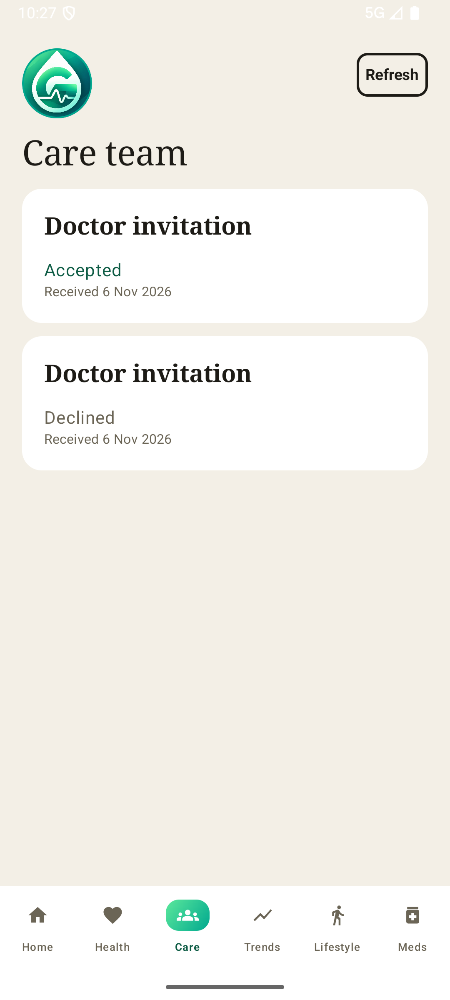

# Patient Mobile App

Native Android patient application for account access and consent-based doctor connections.

## Stack and setup

- Kotlin and Jetpack Compose with Material 3.
- Package: `com.glycotwin.patient`.
- Minimum Android SDK: 26.
- Android Studio with an Android Emulator.
- Retrofit/Gson for HTTP, Coroutines/StateFlow for state, Android Keystore for session tokens.

Open `apps/patient_mobile` in Android Studio and run the `app` configuration after starting the API. PowerShell commands:

```powershell
.\gradlew.bat :app:assembleDebug
.\gradlew.bat :app:testDebugUnitTest
```

The API URL is a Gradle build property:

```powershell
.\gradlew.bat :app:assembleDebug "-PAPI_BASE_URL=http://10.0.2.2:5000/api/v1/"
```

`10.0.2.2` is the Android Emulator alias for the Windows host. If the Windows emulator networking layer does not route that address, use the host's reachable LAN address instead. Debug builds allow cleartext HTTP; production builds do not.

## Integrated workflow

- Patient registration and login.
- Session restore, refresh, and logout.
- Profile completion after login, profile retrieval, and patient-owned profile updates.
- Editable full name, date of birth, gender, and diabetes type; email is read-only.
- Health Records tab with manual glucose entry, native date/time pickers, history, editing, deletion confirmation, and refresh.
- `GET /patient/invitations`.
- Accept/decline through `POST /patient/invitations/:id/respond`.
- Care Team invitation loading, refresh, action states, and errors.
- Dashboard pending-invitation count and accepted-invitation connection status.

## Limitations

The API currently has no patient-side relationship-list endpoint. The app therefore does not invent one; connected-doctor information is shown only when supported by returned accepted-invitation data. Gender and diabetes type remain validated text fields because the existing database has no enum values. Health metrics, device data, recommendations, and ML predictions are intentionally not implemented.


## Project Screenshots

<table>
  <tr>
    <td align="center">
      
      <br><strong>GlycoTwin Overview</strong>
    </td>
    <td align="center">
      
      <br><strong>Patient App</strong>
    </td>
    <td align="center">
      
      <br><strong>Dashboard</strong>
    </td>
    <td align="center">
      
      <br><strong>Health Tracking</strong>
    </td>
  </tr>

  <tr>
    <td align="center">
      
      <br><strong>Health Trends</strong>
    </td>
    <td align="center">
      
      <br><strong>Medicine Tracking</strong>
    </td>
    <td align="center">
      
      <br><strong>Doctor Connection</strong>
    </td>
  </tr>
</table>


