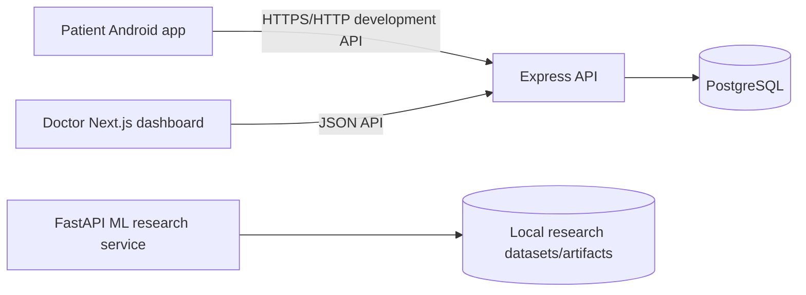

# System architecture

## Components

- **Patient Android application:** Kotlin/Compose UI, authenticated Retrofit calls, Keystore-backed session storage, and StateFlow view models.
- **Doctor web dashboard:** Next.js pages-router application using Axios, TanStack Query, and Zustand.
- **Express API:** Owns validation, authentication, authorization, connection business rules, audit events, and database access.
- **PostgreSQL:** Stores users, profiles, invitations, relationships, refresh-token hashes, and audit logs. Drizzle owns schema access and migrations.
- **Python ML service:** Separate FastAPI research prototype for an educational diabetes classification experiment. It is not connected to patient clinical decisions.

## Authentication and authorization

The API returns a short-lived signed access token and an opaque refresh token. Refresh tokens are rotated and only their hashes are persisted. Protected routes require a bearer access token; connection routes additionally enforce active patient authentication, patient role, and verified doctor requirements where applicable.

## Consent workflow

1. A verified doctor searches for a patient by exact email.
2. The doctor creates a pending invitation.
3. The patient retrieves invitations in the Android app.
4. The patient accepts or declines the invitation.
5. Acceptance creates an active doctor-patient relationship in the same backend transaction.
6. The doctor dashboard lists the patient after consent.

An invitation alone does not grant health-data access. Revocation and audit records preserve the relationship history.
